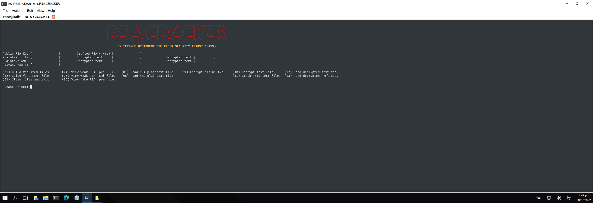

# RSA CRACKER 3.0

* A Python script for educational RSA cryptography analysis and recovery of private keys from deliberately weak RSA public keys (.PUB / .XML).

<p align="center">
  
</p>

---

## PROJECT INFORMATION

**Usage:**
```bash
python3 rsa-cracker.py
```

| LANGUAGE | FILENAME | MD5 HASH |
|---|---|---|
| Python 3 | `rsa-cracker.py` | `687daf4036991a83197eb085b70e4616` |
| Python 3 | `createfiles.py` | `6f2e34896d98be45ce3f1e49ee92f134` |

---

## REQUIREMENTS

- [x] Python 3
- [x] Third-party RSA analysis tool: [RsaCtfTool](https://pypi.org/project/rsactftool/)

**Installation:**

It is recommended to use a Python virtual environment.

```bash
python3 -m venv .venv
source .venv/bin/activate
pip install RsaCtfTool
```

---

## OVERVIEW

RSA-CRACKER 3.0 is a Python-based educational cryptography project demonstrating weaknesses in improperly generated RSA keys.

The project explores RSA public-key analysis and the recovery of private-key information where deliberately weak key parameters make this mathematically possible.

It demonstrates the importance of secure RSA key generation and appropriate cryptographic key sizes.

---

## CONSOLE DISPLAY



---

## LEGAL DISCLAIMER

This software is intended for educational purposes, authorised security research and cryptography testing.

Only use this software against keys and encrypted messages that you own or have explicit permission to analyse.

The developer accepts no responsibility for unauthorised use or misuse of this software.
